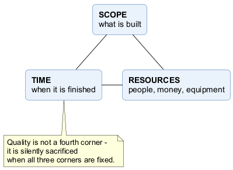

# Presentations with Markdown and reveal.js

Max Muster, 3CHIF

---

## Why slides as text?

- Version control with git, just like source code <!-- .element: class="fragment" -->
- Several people can work on it at the same time <!-- .element: class="fragment" -->
- Code examples with syntax highlighting <!-- .element: class="fragment" -->
- The result is a web page: runs in any browser <!-- .element: class="fragment" -->

Note:
These are speaker notes. Press S to open the speaker view.

---

## Vertical slides

A line with `--` creates a sub-slide.

Continue with the down arrow.

--

## Code: Java

```java [3]
public class HelloWorld {
    public static void main(String[] args) {
        System.out.println("Hello, World!");
    }
}
```

--

## Code: step by step

```typescript [1|2|3]
const numbers = [1, 2, 3, 4, 5];
const sum = numbers.reduce((a, b) => a + b, 0);
console.log('Sum:', sum);
```

---

## Image

 <!-- .element: style="height: 60vh" -->

---

## Image and text side by side

<div class="columns">
<div>


</div>
<div>

- Scope
- Time
- Resources

If one corner changes, the others change with it.

</div>
</div>

---

## Table

| Key | Effect |
| --- | --- |
| `F` | Full screen |
| `S` | Speaker view with notes |
| `O` or `Esc` | Slide overview |
| `B` | Black screen |

---

<!-- .slide: data-background-color="#1e3a5f" -->

## Thank you!

Questions?
